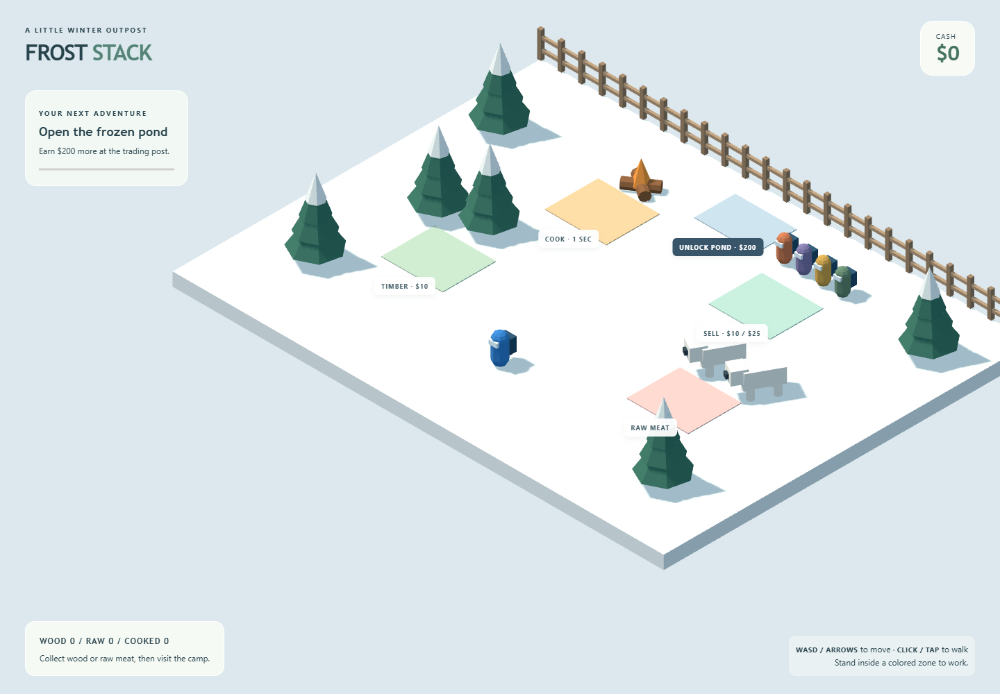
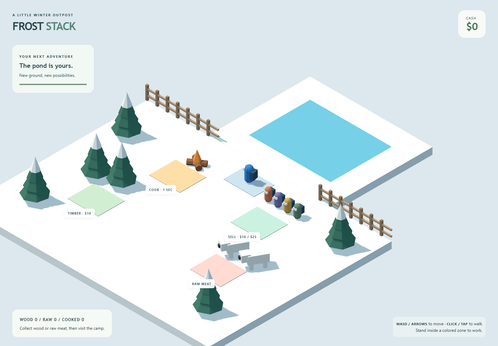

```text
Frost stack/
├── .gitignore
├── index.html
├── package.json
├── package-lock.json        # generated dependency lockfile
├── README.md
├── SOURCE.md                # complete file-by-file source listing
├── docs/
│   └── images/
│       ├── outpost.png
│       └── pond-open.png
├── scripts/
│   └── smoke.mjs
├── src/
│   ├── main.js
│   ├── config.js
│   ├── style.css
│   ├── assets/
│   │   └── AssetFactory.js
│   ├── engine/
│   │   ├── GameManager.js
│   │   └── SceneSetup.js
│   ├── entities/
│   │   └── PlayerController.js
│   ├── systems/
│   │   ├── InventoryStack.js
│   │   ├── TriggerZone.js
│   │   ├── ResourceSystem.js
│   │   ├── InteractionSystem.js
│   │   └── ExpansionSystem.js
│   ├── ui/
│   │   └── HUD.js
│   ├── utils/
│   │   └── math.js
│   └── world/
│       └── World.js
└── tests/
    └── systems.test.js
```

Complete runnable Vite + Three.js project. Run `npm install` and `npm run dev`. Every hand-written file is reproduced below. The generated `package-lock.json` is supplied separately in the project; this source listing does not reproduce itself.

## .gitignore

```text
node_modules/
dist/
.artifacts/
*.log

.env
.env.*
!.env.example
```

## package.json

```json
{
  "name": "frost-stack",
  "version": "1.0.0",
  "private": true,
  "type": "module",
  "engines": {
    "node": ">=22.12.0"
  },
  "scripts": {
    "dev": "vite --host 127.0.0.1",
    "build": "vite build",
    "preview": "vite preview --host 127.0.0.1",
    "test": "node --test",
    "test:browser": "node scripts/smoke.mjs"
  },
  "dependencies": {
    "three": "0.180.0"
  },
  "devDependencies": {
    "@playwright/test": "1.63.0",
    "vite": "8.3.0"
  }
}
```

## index.html

```html
<!doctype html>
<html lang="en">
  <head>
    <meta charset="UTF-8" />
    <meta name="viewport" content="width=device-width, initial-scale=1" />
    <meta name="theme-color" content="#e5edf0" />
    <title>Frost Stack</title><link rel="icon" href="data:," />
  </head>
  <body>
    <main id="app" aria-label="Frost Stack game"></main>
    <div id="hud">
      <header><div><small>A LITTLE WINTER OUTPOST</small><h1>FROST <span>STACK</span></h1></div>
        <div class="wallet">CASH <strong id="cash">$0</strong></div></header>
      <aside><small>YOUR NEXT ADVENTURE</small><h2 id="objective">Open the frozen pond</h2>
        <p id="progress">Earn $200 at the trading post.</p><progress id="goal" max="200" value="0"></progress></aside>
      <div id="labels"></div>
      <footer><div><strong id="inventory">Backpack empty</strong><p id="activity" role="status">Walk to the trees to collect wood.</p></div>
        <p class="controls"><b>WASD / ARROWS</b> to move · <b>CLICK / TAP</b> to walk<br />Stand inside a colored zone to work.</p></footer>
    </div>
    <script type="module" src="/src/main.js"></script>
  </body>
</html>
```

## src/config.js

```javascript
export const CONFIG = Object.freeze({
  speed: 5, turnSpeed: 12, cameraFollow: 4, viewHeight: 24,
  playerRadius: 0.35, playerHeight: 1.7,
  fixedStep: 1 / 60, maxFrameDelta: 0.1,
  harvestSeconds: 0.4, cookSeconds: 1, sellSeconds: 0.2,
  pondCost: 200, stackGap: 0.025,
});

export const RESOURCE = Object.freeze({
  wood: { color: 0x91603b, value: 10 },
  rawMeat: { color: 0xe66b68, value: 0 },
  cookedMeat: { color: 0x975533, value: 25 },
  cash: { color: 0x72bd76, value: 0 },
});
```

## src/utils/math.js

```javascript
export const damping = (rate, dt) => 1 - Math.exp(-rate * dt);
export const easeInOutCubic = t => t < 0.5 ? 4 * t ** 3 : 1 - (-2 * t + 2) ** 3 / 2;

export function tween(from, to, elapsed, duration) {
  const t = Math.min(1, Math.max(0, elapsed / duration));
  return from + (to - from) * easeInOutCubic(t);
}
```

## src/assets/AssetFactory.js

```javascript
import * as THREE from 'three';
import { RESOURCE } from '../config.js';

export class AssetFactory {
  constructor() {
    this.geometries = new Set();
    this.materials = new Map();
    this.resourceGeometries = new Map();
  }

  mesh(geometry, color) {
    this.geometries.add(geometry);
    if (!this.materials.has(color)) {
      this.materials.set(color, new THREE.MeshStandardMaterial({ color, roughness: 0.9, flatShading: true }));
    }
    const mesh = new THREE.Mesh(geometry, this.materials.get(color));
    mesh.castShadow = mesh.receiveShadow = true;
    return mesh;
  }

  box(w, h, d, color) { return this.mesh(new THREE.BoxGeometry(w, h, d), color); }
  cylinder(top, bottom, height, color) {
    return this.mesh(new THREE.CylinderGeometry(top, bottom, height, 8), color);
  }

  player(color = 0x3284cf) {
    const group = new THREE.Group();
    const body = this.mesh(new THREE.CapsuleGeometry(0.33, 0.8, 4, 8), color);
    body.position.y = 0.75;
    const backpack = this.box(0.55, 0.65, 0.32, 0x24516e);
    backpack.position.set(0, 0.8, -0.38);
    const face = this.box(0.4, 0.2, 0.12, 0xe4f6ff);
    face.position.set(0, 1.1, 0.3);
    group.add(body, backpack, face);
    return group;
  }

  tree() {
    const group = new THREE.Group();
    const trunk = this.cylinder(0.18, 0.24, 1, 0x795039);
    trunk.position.y = 0.5;
    group.add(trunk);
    for (let i = 0; i < 3; i++) {
      const cone = this.mesh(new THREE.ConeGeometry(1.1 - i * 0.25, 1.7, 7), 0x377464);
      cone.position.y = 1.4 + i * 0.65;
      const snow = this.mesh(new THREE.ConeGeometry(0.75 - i * 0.18, 1.15, 7), 0xf0f7f7);
      snow.position.y = cone.position.y + 0.42;
      group.add(cone, snow);
    }
    return group;
  }

  bear() {
    const group = new THREE.Group();
    const body = this.box(0.9, 0.7, 1.55, 0xfffcf2);
    body.position.y = 0.85;
    const head = this.box(0.7, 0.6, 0.65, 0xfffcf2);
    head.position.set(0, 1, 0.9);
    const nose = this.box(0.25, 0.2, 0.15, 0x304551);
    nose.position.set(0, 0.98, 1.27);
    group.add(body, head, nose);
    for (const x of [-0.3, 0.3]) for (const z of [-0.5, 0.5]) {
      const leg = this.cylinder(0.15, 0.16, 0.5, 0xfffcf2);
      leg.position.set(x, 0.25, z);
      group.add(leg);
    }
    return group;
  }

  resource(type) {
    if (!RESOURCE[type]) throw new Error(`Unknown resource: ${type}`);
    if (!this.resourceGeometries.has(type)) {
      const geometry = type === 'wood'
        ? new THREE.CylinderGeometry(0.16, 0.16, 0.72, 8).rotateZ(Math.PI / 2)
        : new THREE.BoxGeometry(0.65, 0.18, 0.42);
      geometry.computeBoundingBox();
      this.resourceGeometries.set(type, geometry);
    }
    const geometry = this.resourceGeometries.get(type);
    const mesh = this.mesh(geometry, RESOURCE[type].color);
    mesh.userData.height = geometry.boundingBox.max.y - geometry.boundingBox.min.y;
    return mesh;
  }

  campfire() {
    const group = new THREE.Group();
    for (const angle of [-0.6, 0.6]) {
      const log = this.resource('wood');
      log.scale.set(2, 1.5, 1.5);
      log.rotation.y = angle;
      log.position.y = 0.22;
      group.add(log);
    }
    const flame = this.mesh(new THREE.ConeGeometry(0.38, 1.1, 5), 0xff9d42);
    flame.position.y = 0.8;
    group.add(flame);
    return group;
  }

  fence(width = 1) {
    const group = new THREE.Group();
    const post = this.box(0.18, 1.3, 0.18, 0x9c8065);
    post.position.y = 0.65;
    group.add(post);
    for (const y of [0.4, 0.95]) {
      const rail = this.box(width, 0.13, 0.12, 0xb59779);
      rail.position.set(width / 2, y, 0);
      group.add(rail);
    }
    return group;
  }

  dispose() {
    for (const geometry of this.geometries) geometry.dispose();
    for (const material of this.materials.values()) material.dispose();
    this.geometries.clear();
    this.materials.clear();
    this.resourceGeometries.clear();
  }
}
```

## src/engine/SceneSetup.js

```javascript
import * as THREE from 'three';
import { CONFIG } from '../config.js';
import { damping } from '../utils/math.js';

export class SceneSetup {
  constructor(container) {
    this.container = container;
    this.scene = new THREE.Scene();
    this.scene.background = new THREE.Color(0xdce8ed);
    this.camera = new THREE.OrthographicCamera(-1, 1, 1, -1, 0.1, 150);
    // Equal XYZ offset gives a 45° azimuth and classic 35.264° isometric elevation.
    this.offset = new THREE.Vector3(22, 22, 22);
    this.focus = new THREE.Vector3(0, 0.8, 4);
    this.desired = new THREE.Vector3();
    this.renderer = new THREE.WebGLRenderer({ antialias: true });
    this.renderer.shadowMap.enabled = true;
    this.renderer.shadowMap.type = THREE.PCFSoftShadowMap;
    this.renderer.outputColorSpace = THREE.SRGBColorSpace;
    this.renderer.setPixelRatio(Math.min(window.devicePixelRatio, 2));
    this.renderer.domElement.setAttribute('aria-label', 'Isometric snowy outpost. Use WASD or click to move.');
    container.append(this.renderer.domElement);
    this.scene.add(new THREE.HemisphereLight(0xd5efff, 0x8397ac, 2));
    this.sun = new THREE.DirectionalLight(0xfff1dc, 3);
    this.sun.position.set(-12, 24, 8);
    this.sun.castShadow = true;
    this.sun.shadow.mapSize.set(2048, 2048);
    Object.assign(this.sun.shadow.camera, { left: -30, right: 30, top: 30, bottom: -30, near: 0.5, far: 80 });
    this.sun.shadow.normalBias = 0.025;
    this.sun.shadow.camera.updateProjectionMatrix();
    this.scene.add(this.sun, this.sun.target);
    this.resize = () => {
      const { clientWidth: w, clientHeight: h } = container;
      const aspect = w / Math.max(1, h);
      const half = CONFIG.viewHeight / 2;
      Object.assign(this.camera, { left: -half * aspect, right: half * aspect, top: half, bottom: -half });
      this.camera.updateProjectionMatrix();
      this.renderer.setSize(w, h);
    };
    this.observer = new ResizeObserver(this.resize);
    this.observer.observe(container);
    this.resize();
    this.follow(this.focus, 0);
  }

  follow(position, dt) {
    this.desired.set(position.x, 0.8, position.z);
    this.focus.lerp(this.desired, damping(CONFIG.cameraFollow, dt));
    this.camera.position.copy(this.focus).add(this.offset);
    this.camera.lookAt(this.focus);
    this.camera.updateMatrixWorld();
  }

  render() { this.renderer.render(this.scene, this.camera); }

  dispose() {
    this.observer.disconnect();
    this.sun.shadow.map?.dispose();
    this.renderer.dispose();
    this.renderer.domElement.remove();
  }
}
```

## src/systems/TriggerZone.js

```javascript
import * as THREE from 'three';

export class TriggerZone {
  constructor(x, z, width = 3, depth = 2.6) {
    this.center = new THREE.Vector3(x, 0.8, z);
    this.size = new THREE.Vector3(width, 2, depth);
    this.bounds = new THREE.Box3().setFromCenterAndSize(this.center, this.size);
  }

  intersects(playerBounds) { return this.bounds.intersectsBox(playerBounds); }
}
```

## src/world/World.js

```javascript
import * as THREE from 'three';
import { TriggerZone } from '../systems/TriggerZone.js';
import { CONFIG } from '../config.js';

export class World {
  constructor(scene, factory) {
    this.unlocked = false;
    this.zones = {
      wood: new TriggerZone(-6, 1), rawMeat: new TriggerZone(6, 1),
      fire: new TriggerZone(-4, -5), crowd: new TriggerZone(4, -5),
      buy: new TriggerZone(0, -8, 3, 2),
    };
    const ground = factory.box(24, 0.65, 18, 0xecf4f4);
    ground.position.set(0, -0.325, -1);
    scene.add(ground);
    this.pond = new THREE.Group();
    const bank = factory.box(12, 0.65, 10, 0xecf4f4);
    bank.position.set(0, -0.325, -15);
    const water = factory.mesh(new THREE.PlaneGeometry(8, 6), 0x65b9d3);
    water.rotation.x = -Math.PI / 2;
    water.position.set(0, 0.025, -15);
    water.castShadow = false;
    this.pond.add(bank, water);
    this.pond.visible = false;
    scene.add(this.pond);
    const colors = { wood: 0xbdd5bf, rawMeat: 0xe8c3bf, fire: 0xefc797, crowd: 0xb6d8cc, buy: 0xbacddb };
    for (const [name, zone] of Object.entries(this.zones)) {
      const pad = factory.box(zone.size.x, 0.04, zone.size.z, colors[name]);
      pad.position.set(zone.center.x, 0.025, zone.center.z);
      scene.add(pad);
    }
    for (const [x, z] of [[-8, -1], [-6, -1.5], [-9, 4], [-10, -6], [9, 5], [10, -7]]) {
      const tree = factory.tree();
      tree.position.set(x, 0, z);
      scene.add(tree);
    }
    for (const x of [5.5, 7.5]) {
      const bear = factory.bear();
      bear.position.set(x, 0, -1.3);
      bear.rotation.y = -0.5;
      scene.add(bear);
    }
    const fire = factory.campfire();
    fire.position.set(-4, 0, -6.9);
    scene.add(fire);
    for (let i = 0; i < 4; i++) {
      const customer = factory.player([0xd27a53, 0x8179a8, 0xd4a54f, 0x688c73][i]);
      customer.position.set(2.6 + i * 0.95, 0, -7.3);
      customer.scale.setScalar(0.85);
      scene.add(customer);
    }
    this.gate = [];
    for (let x = -12; x < 12; x++) {
      const segment = factory.fence();
      segment.position.set(x, 0, -10);
      scene.add(segment);
      if (x >= -5 && x < 5) this.gate.push(segment);
    }
  }

  canStand(x, z) {
    const r = CONFIG.playerRadius;
    if (z >= -10 + r) return x >= -12 + r && x <= 12 - r && z <= 8 - r;
    return this.unlocked && Math.abs(x) <= 5 - r && z >= -20 + r;
  }
}
```

## src/entities/PlayerController.js

```javascript
import * as THREE from 'three';
import { CONFIG } from '../config.js';
import { damping } from '../utils/math.js';

export class PlayerController {
  constructor(player, camera, canvas, world) {
    Object.assign(this, { player, camera, canvas, world });
    this.keys = new Set();
    this.target = null;
    this.direction = new THREE.Vector3();
    this.rotation = new THREE.Quaternion();
    this.up = new THREE.Vector3(0, 1, 0);
    this.raycaster = new THREE.Raycaster();
    this.ground = new THREE.Plane(this.up, 0);
    this.pointer = new THREE.Vector2();
    this.bounds = new THREE.Box3();
    this.center = new THREE.Vector3();
    this.bodySize = new THREE.Vector3(CONFIG.playerRadius * 2, CONFIG.playerHeight, CONFIG.playerRadius * 2);
    this.events = new AbortController();
    const options = { signal: this.events.signal };
    const movementKeys = new Set(['KeyW', 'KeyA', 'KeyS', 'KeyD', 'ArrowUp', 'ArrowDown', 'ArrowLeft', 'ArrowRight']);
    window.addEventListener('keydown', event => {
      if (movementKeys.has(event.code)) {
        event.preventDefault();
        this.keys.add(event.code);
        this.target = null;
      }
    }, options);
    window.addEventListener('keyup', event => this.keys.delete(event.code), options);
    window.addEventListener('blur', () => this.clearInput(), options);
    canvas.addEventListener('pointerdown', event => {
      if (event.button !== 0) return;
      const rect = canvas.getBoundingClientRect();
      this.pointer.set((event.clientX - rect.left) / rect.width * 2 - 1, -(event.clientY - rect.top) / rect.height * 2 + 1);
      this.raycaster.setFromCamera(this.pointer, camera);
      const point = this.raycaster.ray.intersectPlane(this.ground, new THREE.Vector3());
      if (point && world.canStand(point.x, point.z)) this.target = point;
    }, options);
    this.updateBounds();
  }

  update(dt) {
    const pressed = (...codes) => codes.some(code => this.keys.has(code));
    const x = Number(pressed('KeyD', 'ArrowRight')) - Number(pressed('KeyA', 'ArrowLeft'));
    const y = Number(pressed('KeyW', 'ArrowUp')) - Number(pressed('KeyS', 'ArrowDown'));
    // Screen-relative input for the fixed 45-degree camera.
    this.direction.set(x - y, 0, -x - y);
    let distance = Infinity;
    if (this.direction.lengthSq()) this.target = null;
    else if (this.target) {
      this.direction.subVectors(this.target, this.player.position);
      this.direction.y = 0;
      distance = this.direction.length();
      if (distance < 0.04) { this.target = null; this.direction.set(0, 0, 0); }
    }
    if (this.direction.lengthSq()) {
      this.direction.normalize();
      const step = Math.min(CONFIG.speed * dt, distance);
      const p = this.player.position;
      const oldX = p.x, oldZ = p.z;
      if (this.world.canStand(p.x + this.direction.x * step, p.z)) p.x += this.direction.x * step;
      if (this.world.canStand(p.x, p.z + this.direction.z * step)) p.z += this.direction.z * step;
      this.direction.set(p.x - oldX, 0, p.z - oldZ);
      if (this.direction.lengthSq() > 1e-10) {
        this.rotation.setFromAxisAngle(this.up, Math.atan2(this.direction.x, this.direction.z));
        this.player.quaternion.slerp(this.rotation, damping(CONFIG.turnSpeed, dt));
      } else this.target = null;
    }
    this.updateBounds();
  }

  updateBounds() {
    this.center.copy(this.player.position).y += CONFIG.playerHeight / 2;
    this.bounds.setFromCenterAndSize(this.center, this.bodySize);
  }

  clearInput() { this.keys.clear(); this.target = null; }
  dispose() { this.events.abort(); }
}
```

## src/systems/InventoryStack.js

```javascript
import * as THREE from 'three';
import { CONFIG } from '../config.js';

export class InventoryStack {
  constructor(player, factory) {
    this.factory = factory;
    this.items = [];
    this.group = new THREE.Group();
    this.group.position.set(0, 1.2, -0.4);
    player.add(this.group);
  }

  add(type) {
    const mesh = this.factory.resource(type);
    this.items.push({ type, mesh, height: mesh.userData.height });
    this.group.add(mesh);
    this.reflow();
  }

  remove(type) {
    // Remove the highest matching item, including from a mixed stack.
    const index = this.items.findLastIndex(item => item.type === type);
    if (index < 0) return false;
    const [item] = this.items.splice(index, 1);
    this.group.remove(item.mesh);
    // Shared geometry and materials remain owned by AssetFactory.
    this.reflow();
    return true;
  }

  count(type) { return this.items.filter(item => item.type === type).length; }

  reflow() {
    let y = 0;
    for (const item of this.items) {
      item.mesh.position.y = y + item.height / 2;
      y += item.height + CONFIG.stackGap;
    }
  }
}
```

## src/systems/ResourceSystem.js

```javascript
import { CONFIG } from '../config.js';

export class ResourceSystem {
  constructor(zones, inventory) {
    this.zones = zones;
    this.inventory = inventory;
    this.elapsed = { wood: 0, rawMeat: 0 };
  }

  update(dt, bounds) {
    for (const type of ['wood', 'rawMeat']) {
      if (!this.zones[type].intersects(bounds)) { this.elapsed[type] = 0; continue; }
      this.elapsed[type] += dt;
      while (this.elapsed[type] + 1e-9 >= CONFIG.harvestSeconds) {
        this.elapsed[type] -= CONFIG.harvestSeconds;
        this.inventory.add(type);
      }
    }
  }
}
```

## src/systems/InteractionSystem.js

```javascript
import { CONFIG, RESOURCE } from '../config.js';

export class InteractionSystem {
  constructor(zones, inventory, wallet) {
    Object.assign(this, { zones, inventory, wallet });
    this.cooking = null;
    this.saleTime = 0;
  }

  update(dt, bounds) {
    // An accepted cooking job finishes even if the player leaves the fire.
    if (this.cooking !== null) {
      this.cooking -= dt;
      if (this.cooking <= 1e-9) {
        this.inventory.add('cookedMeat');
        this.cooking = null;
      }
    }
    if (this.cooking === null && this.zones.fire.intersects(bounds) && this.inventory.remove('rawMeat')) {
      this.cooking = CONFIG.cookSeconds;
    }
    if (!this.zones.crowd.intersects(bounds)) { this.saleTime = 0; return; }
    this.saleTime += dt;
    while (this.saleTime + 1e-9 >= CONFIG.sellSeconds) {
      this.saleTime -= CONFIG.sellSeconds;
      const type = this.inventory.count('cookedMeat') ? 'cookedMeat' : 'wood';
      if (!this.inventory.remove(type)) { this.saleTime = 0; break; }
      this.wallet.cash += RESOURCE[type].value;
    }
  }
}
```

## src/systems/ExpansionSystem.js

```javascript
import { CONFIG } from '../config.js';
import { tween } from '../utils/math.js';

export class ExpansionSystem {
  constructor(world, wallet) {
    Object.assign(this, { world, wallet });
    this.state = 'locked';
    this.elapsed = 0;
  }

  update(dt, bounds) {
    if (this.state === 'locked' && this.world.zones.buy.intersects(bounds) && this.wallet.cash >= CONFIG.pondCost) {
      this.wallet.cash -= CONFIG.pondCost;
      this.state = 'opening'; // Commit once before animating.
      this.world.pond.visible = true;
    }
    if (this.state !== 'opening') return;
    this.elapsed += dt;
    this.world.gate.forEach((segment, i) => {
      segment.position.y = tween(0, -1.6, this.elapsed - i * 0.04, 0.8);
    });
    if (this.elapsed >= 0.8 + (this.world.gate.length - 1) * 0.04) {
      this.state = 'open';
      this.world.unlocked = true;
      for (const segment of this.world.gate) segment.visible = false;
    }
  }
}
```

## src/ui/HUD.js

```javascript
import * as THREE from 'three';
import { CONFIG } from '../config.js';

export class HUD {
  constructor(world) {
    this.cash = document.querySelector('#cash');
    this.inventory = document.querySelector('#inventory');
    this.activity = document.querySelector('#activity');
    this.goal = document.querySelector('#goal');
    this.objective = document.querySelector('#objective');
    this.progress = document.querySelector('#progress');
    this.container = document.querySelector('#labels');
    this.projected = new THREE.Vector3();
    const names = { wood: 'TIMBER · $10', rawMeat: 'RAW MEAT', fire: 'COOK · 1 SEC', crowd: 'SELL · $10 / $25', buy: 'UNLOCK POND · $' + CONFIG.pondCost };
    this.labels = Object.entries(world.zones).map(([name, zone]) => {
      const element = document.createElement('div');
      element.className = 'zone-label ' + name;
      element.textContent = names[name];
      this.container.append(element);
      return { name, zone, element };
    });
  }

  text(element, value) { if (element.textContent !== value) element.textContent = value; }

  update(game) {
    const { inventory, wallet, expansion, interactions, world, playerController, sceneSetup } = game;
    this.text(this.cash, '$' + wallet.cash);
    const counts = ['wood', 'rawMeat', 'cookedMeat'].map(type => inventory.count(type));
    this.text(this.inventory, 'WOOD ' + counts[0] + '  /  RAW ' + counts[1] + '  /  COOKED ' + counts[2]);
    this.goal.value = expansion.state === 'locked' ? wallet.cash : CONFIG.pondCost;
    this.text(this.objective, expansion.state === 'open' ? 'The pond is yours.' : 'Open the frozen pond');
    this.text(this.progress, expansion.state === 'locked' ? 'Earn $' + Math.max(0, CONFIG.pondCost - wallet.cash) + ' more at the trading post.' : 'New ground, new possibilities.');
    let activity = 'Collect wood or raw meat, then visit the camp.';
    if (interactions.cooking !== null) activity = 'Cooking… ' + Math.max(0, interactions.cooking).toFixed(1) + 's';
    else if (world.zones.crowd.intersects(playerController.bounds)) activity = 'Trading wood ($10) and cooked meat ($25).';
    else if (world.zones.wood.intersects(playerController.bounds)) activity = 'Gathering timber… watch that stack grow.';
    else if (world.zones.rawMeat.intersects(playerController.bounds)) activity = 'Gathering raw meat… take it to the fire.';
    this.text(this.activity, activity);
    const rect = sceneSetup.renderer.domElement.getBoundingClientRect();
    for (const { name, zone, element } of this.labels) {
      this.projected.set(zone.center.x, 0.1, zone.center.z + zone.size.z / 2 + 0.35).project(sceneSetup.camera);
      const p = this.projected;
      element.hidden = Math.abs(p.x) > 1 || Math.abs(p.y) > 1 || Math.abs(p.z) > 1 || (name === 'buy' && expansion.state !== 'locked');
      element.style.left = (rect.left + (p.x + 1) * rect.width / 2) + 'px';
      element.style.top = (rect.top + (1 - p.y) * rect.height / 2) + 'px';
    }
  }

  dispose() { this.container.replaceChildren(); }
}
```

## src/engine/GameManager.js

```javascript
import { CONFIG } from '../config.js';
import { SceneSetup } from './SceneSetup.js';
import { AssetFactory } from '../assets/AssetFactory.js';
import { World } from '../world/World.js';
import { PlayerController } from '../entities/PlayerController.js';
import { InventoryStack } from '../systems/InventoryStack.js';
import { ResourceSystem } from '../systems/ResourceSystem.js';
import { InteractionSystem } from '../systems/InteractionSystem.js';
import { ExpansionSystem } from '../systems/ExpansionSystem.js';
import { HUD } from '../ui/HUD.js';

export class GameManager {
  constructor(container) {
    this.sceneSetup = new SceneSetup(container);
    this.factory = new AssetFactory();
    this.world = new World(this.sceneSetup.scene, this.factory);
    this.player = this.factory.player();
    this.player.position.set(0, 0, 4);
    this.sceneSetup.scene.add(this.player);
    this.wallet = { cash: 0 };
    this.inventory = new InventoryStack(this.player, this.factory);
    this.playerController = new PlayerController(this.player, this.sceneSetup.camera, this.sceneSetup.renderer.domElement, this.world);
    this.resources = new ResourceSystem(this.world.zones, this.inventory);
    this.interactions = new InteractionSystem(this.world.zones, this.inventory, this.wallet);
    this.expansion = new ExpansionSystem(this.world, this.wallet);
    this.hud = new HUD(this.world);
    this.running = false;
    this.accumulator = 0;
    this.previousTime = null;
    this.onVisibility = () => {
      this.previousTime = null;
      this.accumulator = 0;
      this.playerController.clearInput();
    };
    document.addEventListener('visibilitychange', this.onVisibility);
    this.frame = this.frame.bind(this);
  }

  start() {
    if (this.running) return;
    this.running = true;
    this.previousTime = null;
    this.frameId = requestAnimationFrame(this.frame);
  }

  update(dt) {
    this.playerController.update(dt);
    const bounds = this.playerController.bounds;
    this.resources.update(dt, bounds);
    this.interactions.update(dt, bounds);
    this.expansion.update(dt, bounds);
  }

  frame(timestamp) {
    if (!this.running) return;
    const dt = this.previousTime === null ? 0 : Math.min((timestamp - this.previousTime) / 1000, CONFIG.maxFrameDelta);
    this.previousTime = timestamp;
    if (!document.hidden) {
      this.accumulator += dt;
      while (this.accumulator + 1e-9 >= CONFIG.fixedStep) {
        this.update(CONFIG.fixedStep);
        this.accumulator -= CONFIG.fixedStep;
      }
      this.sceneSetup.follow(this.player.position, dt);
      this.sceneSetup.render();
      this.hud.update(this);
    }
    this.frameId = requestAnimationFrame(this.frame);
  }

  dispose() {
    this.running = false;
    cancelAnimationFrame(this.frameId);
    document.removeEventListener('visibilitychange', this.onVisibility);
    this.playerController.dispose();
    this.hud.dispose();
    this.factory.dispose();
    this.sceneSetup.dispose();
  }
}
```

## src/main.js

```javascript
import './style.css';
import { GameManager } from './engine/GameManager.js';

export let game;
try {
  game = new GameManager(document.querySelector('#app'));
  game.start();
  if (import.meta.hot) import.meta.hot.dispose(() => game.dispose());
} catch (error) {
  document.querySelector('#activity').textContent = 'Could not start the 3D scene. A WebGL2-capable browser is required.';
  console.error(error);
}
```

## src/style.css

```css
:root { font-family: 'Segoe UI', system-ui, sans-serif; color: #29444d; font-synthesis: none; }
* { box-sizing: border-box; }
body { margin: 0; overflow: hidden; background: #dce8ed; }
#app, #hud { position: fixed; inset: 0; }
canvas { display: block; width: 100%; height: 100%; touch-action: none; }
#hud { pointer-events: none; }
header { position: absolute; inset: 30px 36px auto; display: flex; justify-content: space-between; align-items: start; }
small { font-size: 10px; font-weight: 700; letter-spacing: 2px; }
h1, h2, strong { font-family: 'Trebuchet MS', system-ui, sans-serif; }
h1 { margin: 6px 0; font-size: 32px; letter-spacing: -1.5px; }
h1 span { color: #558477; }
.wallet { background: #f9fcf6e8; padding: 14px 22px; border: 1px solid #fff; border-radius: 18px; font-size: 10px; letter-spacing: 1px; }
.wallet strong { display: block; font-size: 30px; letter-spacing: -1px; color: #46745e; }
aside { position: absolute; top: 130px; left: 36px; width: 235px; padding: 19px; background: #f8fcf6cc; border-radius: 16px; border: 1px solid #ffffffb0; }
h2 { margin: 8px 0; font-size: 18px; }
p { font-size: 12px; line-height: 1.6; margin: 7px 0 0; }
progress { margin-top: 14px; width: 100%; height: 6px; accent-color: #60896b; }
footer { position: absolute; bottom: 26px; left: 36px; right: 36px; display: flex; justify-content: space-between; align-items: end; gap: 20px; }
footer > div { padding: 15px 20px; border: 1px solid #fff; border-radius: 14px; background: #f8fcf5e8; }
footer strong { font-size: 12px; letter-spacing: 1px; }
.controls { text-align: right; padding: 10px; border-radius: 10px; background: #ecf4f4cc; }
.controls b { font-size: 10px; letter-spacing: 0.5px; }
.zone-label { position: absolute; transform: translate(-50%, 0); white-space: nowrap; font-size: 9px; font-weight: 700; letter-spacing: 1px; color: #46606a; background: #fffffff0; border-radius: 6px; padding: 7px 10px; box-shadow: 0 3px 8px #20384410; }
.zone-label.buy { color: #fff; background: #38556a; }
@media (max-width: 650px) {
  header { inset: 18px 18px auto; }
  h1 { font-size: 25px; }
  aside { top: 110px; left: 18px; width: 190px; padding: 12px; }
  aside small { font-size: 8px; }
  h2 { font-size: 15px; }
  footer { bottom: 18px; left: 18px; right: 18px; }
  .controls { display: none; }
  .zone-label { font-size: 8px; padding: 5px 7px; }
}
```

## tests/systems.test.js

```javascript
import test from 'node:test';
import assert from 'node:assert/strict';
import * as THREE from 'three';
import { AssetFactory } from '../src/assets/AssetFactory.js';
import { InventoryStack } from '../src/systems/InventoryStack.js';
import { ResourceSystem } from '../src/systems/ResourceSystem.js';
import { InteractionSystem } from '../src/systems/InteractionSystem.js';
import { ExpansionSystem } from '../src/systems/ExpansionSystem.js';
import { PlayerController } from '../src/entities/PlayerController.js';
import { World } from '../src/world/World.js';
import { CONFIG } from '../src/config.js';

function fixture(t) {
  const factory = new AssetFactory();
  t.after(() => factory.dispose());
  const world = new World(new THREE.Scene(), factory);
  const player = factory.player();
  const inventory = new InventoryStack(player, factory);
  const wallet = { cash: 0 };
  const interactions = new InteractionSystem(world.zones, inventory, wallet);
  return { factory, world, player, inventory, wallet, interactions };
}

function bodyAt(x, z) {
  return new THREE.Box3().setFromCenterAndSize(new THREE.Vector3(x, 0.85, z), new THREE.Vector3(0.7, 1.7, 0.7));
}

function advance(system, seconds, bounds) {
  for (let i = 0; i < Math.round(seconds * 60); i++) system.update(1 / 60, bounds);
}

test('mixed stack uses actual mesh heights and closes gaps after middle removal', t => {
  const { inventory } = fixture(t);
  inventory.add('wood');
  inventory.add('rawMeat');
  inventory.add('wood');
  inventory.add('cookedMeat');
  assert.ok(inventory.remove('rawMeat'));
  assert.equal(inventory.remove('rawMeat'), false);
  let expectedBottom = 0;
  for (const item of inventory.items) {
    assert.ok(Math.abs(item.mesh.position.y - item.height / 2 - expectedBottom) < 1e-8);
    expectedBottom += item.height + CONFIG.stackGap;
  }
  assert.equal(inventory.group.children.length, 3);
  assert.ok(inventory.items[0].height > inventory.items[2].height);
});

test('renewable gathering has the same yield with different update intervals', t => {
  const { world, inventory } = fixture(t);
  const source = new ResourceSystem(world.zones, inventory);
  advance(source, 8, bodyAt(-6, 1));
  assert.equal(inventory.count('wood'), 20);
  const second = new InventoryStack(new THREE.Group(), inventory.factory);
  const source2 = new ResourceSystem(world.zones, second);
  for (let i = 0; i < 240; i++) source2.update(1 / 30, bodyAt(-6, 1));
  assert.equal(second.count('wood'), 20);
});

test('cooking consumes one raw item and finishes after one second away from fire', t => {
  const { inventory, interactions } = fixture(t);
  inventory.add('rawMeat');
  inventory.add('rawMeat');
  interactions.update(0, bodyAt(-4, -5));
  assert.equal(inventory.count('rawMeat'), 1);
  advance(interactions, 0.5, bodyAt(0, 4));
  assert.equal(inventory.count('cookedMeat'), 0);
  advance(interactions, 0.5, bodyAt(0, 4));
  assert.equal(inventory.count('cookedMeat'), 1);
  assert.equal(inventory.count('rawMeat'), 1);
  assert.equal(interactions.cooking, null);
});

test('selling respects cadence, prices, and raw-meat exclusion', t => {
  const { inventory, interactions, wallet } = fixture(t);
  for (const type of ['wood', 'rawMeat', 'cookedMeat']) inventory.add(type);
  advance(interactions, 0.1, bodyAt(4, -5));
  assert.equal(wallet.cash, 0);
  advance(interactions, 0.1, bodyAt(4, -5));
  assert.equal(wallet.cash, 25);
  assert.equal(inventory.items.length, 2);
  advance(interactions, 2, bodyAt(4, -5));
  assert.equal(wallet.cash, 35);
  assert.equal(inventory.count('rawMeat'), 1);
});

test('pond purchase is atomic and passage opens only after the fence tween', t => {
  const { world, wallet } = fixture(t);
  const expansion = new ExpansionSystem(world, wallet);
  const bounds = bodyAt(0, -8);
  wallet.cash = 199;
  expansion.update(0, bounds);
  assert.equal(expansion.state, 'locked');
  assert.equal(world.canStand(0, -12), false);
  wallet.cash = 450;
  expansion.update(0, bounds);
  assert.equal(wallet.cash, 250);
  assert.equal(world.pond.visible, true);
  assert.equal(world.canStand(0, -12), false);
  advance(expansion, 2, bounds);
  assert.equal(expansion.state, 'open');
  assert.equal(wallet.cash, 250);
  assert.equal(world.canStand(0, -12), true);
  assert.equal(world.canStand(7, -12), false);
  assert.ok(world.gate.every(segment => !segment.visible && segment.position.y === -1.6));
});

test('normalized WASD speed is independent of frame rate and stack size', t => {
  const oldWindow = globalThis.window;
  globalThis.window = new EventTarget();
  t.after(() => { globalThis.window = oldWindow; });
  for (const fps of [30, 60, 120]) {
    const { player, inventory, world } = fixture(t);
    for (let i = 0; i < 40; i++) inventory.add('wood');
    const controller = new PlayerController(player, new THREE.OrthographicCamera(), new EventTarget(), world);
    controller.keys.add('KeyW');
    controller.keys.add('KeyD');
    for (let i = 0; i < fps; i++) controller.update(1 / fps);
    assert.ok(Math.abs(player.position.length() - CONFIG.speed) < 1e-8);
    assert.equal(controller.bounds.max.y, CONFIG.playerHeight);
    controller.dispose();
  }
});

test('complete gather-sell-buy loop reaches the pond without seeded cash', t => {
  const { world, inventory, wallet, interactions } = fixture(t);
  const resources = new ResourceSystem(world.zones, inventory);
  advance(resources, 8, bodyAt(-6, 1));
  advance(interactions, 4, bodyAt(4, -5));
  assert.equal(wallet.cash, 200);
  assert.equal(inventory.items.length, 0);
  const expansion = new ExpansionSystem(world, wallet);
  advance(expansion, 2, bodyAt(0, -8));
  assert.equal(wallet.cash, 0);
  assert.equal(world.unlocked, true);
});
```

## scripts/smoke.mjs

```javascript
import assert from 'node:assert/strict';
import { existsSync, mkdirSync } from 'node:fs';
import { chromium } from '@playwright/test';
import { createServer } from 'vite';

const server = await createServer({ server: { host: '127.0.0.1', port: 5173 } });
await server.listen();
const edge = 'C:/Program Files (x86)/Microsoft/Edge/Application/msedge.exe';
const executablePath = process.env.FROST_BROWSER_PATH || (existsSync(edge) ? edge : undefined);
let browser;
try {
  browser = await chromium.launch({ executablePath, headless: true, args: ['--use-angle=swiftshader', '--enable-unsafe-swiftshader'] });
  const page = await browser.newPage({ viewport: { width: 1440, height: 1000 } });
  const errors = [];
  page.on('pageerror', error => errors.push(error.message));
  page.on('console', message => { if (message.type() === 'error') errors.push(message.text()); });
  await page.goto(server.resolvedUrls.local[0]);
  await page.waitForFunction(async () => Boolean((await import('/src/main.js')).game?.running));
  await page.evaluate(async () => {
    const { game } = await import('/src/main.js');
    game.running = false;
    cancelAnimationFrame(game.frameId);
  });
  mkdirSync('.artifacts', { recursive: true });
  await page.screenshot({ path: '.artifacts/initial.png' });

  await page.keyboard.down('w');
  const moved = await page.evaluate(async () => {
    const { game } = await import('/src/main.js');
    const start = game.player.position.clone();
    for (let i = 0; i < 60; i++) game.update(1 / 60);
    return game.player.position.distanceTo(start);
  });
  await page.keyboard.up('w');
  assert.ok(Math.abs(moved - 5) < 1e-6, 'WASD travels five units per second');

  const target = await page.evaluate(async () => {
    const { game } = await import('/src/main.js');
    game.sceneSetup.follow(game.player.position, 1);
    game.sceneSetup.render();
    const p = game.world.zones.wood.center.clone();
    p.y = 0;
    p.project(game.sceneSetup.camera);
    return { x: (p.x + 1) * innerWidth / 2, y: (1 - p.y) * innerHeight / 2 };
  });
  await page.mouse.click(target.x, target.y);
  const clicked = await page.evaluate(async () => {
    const { game } = await import('/src/main.js');
    const accepted = Boolean(game.playerController.target);
    for (let i = 0; i < 150; i++) game.update(1 / 60);
    return { accepted, x: game.player.position.x, z: game.player.position.z, wood: game.inventory.count('wood') };
  });
  assert.ok(clicked.accepted, 'Raycast accepts a ground click');
  assert.ok(Math.hypot(clicked.x + 6, clicked.z - 1) < 0.05, 'Click movement reaches its target without overshoot');
  assert.ok(clicked.wood > 0, 'Entering a resource zone gathers items');

  const outcome = await page.evaluate(async () => {
    const { game } = await import('/src/main.js');
    const advance = seconds => { for (let i = 0; i < seconds * 60; i++) game.update(1 / 60); };
    const move = (x, z) => { game.playerController.clearInput(); game.player.position.set(x, 0, z); game.playerController.updateBounds(); };
    while (game.inventory.remove('wood')) {}
    move(0, 4); advance(1);
    move(-6, 1); advance(8);
    const harvested = game.inventory.count('wood');
    move(4, -5); advance(4);
    const earned = game.wallet.cash;
    move(0, -8); advance(2);
    game.sceneSetup.follow(game.player.position, 2);
    game.sceneSetup.render();
    game.hud.update(game);
    return { harvested, earned, cash: game.wallet.cash, state: game.expansion.state, pond: game.world.pond.visible, ortho: game.sceneSetup.camera.isOrthographicCamera };
  });
  assert.deepEqual(outcome, { harvested: 20, earned: 200, cash: 0, state: 'open', pond: true, ortho: true });
  assert.equal(await page.locator('#objective').textContent(), 'The pond is yours.');
  await page.screenshot({ path: '.artifacts/pond-open.png' });
  await page.setViewportSize({ width: 390, height: 844 });
  await page.waitForFunction(async () => (await import('/src/main.js')).game.sceneSetup.renderer.domElement.clientWidth === 390);
  await page.evaluate(async () => {
    const { game } = await import('/src/main.js');
    game.sceneSetup.render(); game.hud.update(game);
  });
  await page.screenshot({ path: '.artifacts/mobile.png' });
  assert.deepEqual(errors, [], 'No browser runtime or console errors');
  console.log('Browser smoke passed: rendering, WASD, raycasting, collecting, selling, unlocking, responsive canvas.');
} finally {
  await browser?.close();
  await server.close();
}
```

## README.md

```markdown
# Frost Stack

A modular Three.js + Vite foundation for a snowy isometric resource game. All models are procedural; no external model, image, or font requests.

## Screenshots

Actual captures of the running game.





## Run

Use Node.js 22.12+ (Node 24 recommended).

~~~sh
npm install
npm run dev
npm test
npm run build
~~~

Open the URL printed by Vite. Use `npm run preview` to serve the production build. Vite uses its defaults, so a config file is unnecessary.

## Play

- WASD or arrow keys move relative to the camera. Click or tap the snow to walk to a destination.
- Stand in TIMBER or RAW MEAT to collect one resource every 0.4 seconds.
- Stand at COOK to convert raw meat to cooked meat, one item per second. A started job finishes even if you walk away.
- Stand at SELL to sell one resource every 0.2 seconds: cooked meat for $25, then wood for $10. Raw meat is not sold.
- Stand at UNLOCK POND with $200 to pay once. The fence sinks in a staggered cubic tween; the path opens when it finishes.
- Example: collect 20 logs, sell them, then enter the buy zone.

## Architecture

`GameManager` owns the lifecycle, fixed-step simulation, and system ordering. `SceneSetup` owns rendering, shadows, resizing, and the orthographic camera. Equal XYZ camera offsets produce a 45-degree azimuth and 35.264-degree isometric elevation. Camera lerp and character quaternion slerp use exponential damping.

`AssetFactory` owns geometry/material lifetime and shares resource geometry. `World` builds terrain, decoration, zones, and the expansion boundary. `PlayerController` owns input, ground raycasting, rotation, and a fixed body AABB that excludes inventory.

`InventoryStack` owns an attached group with mixed resources. Each item's actual geometry height determines its Y offset; removals reflow every remaining item. `ResourceSystem`, `InteractionSystem`, and `ExpansionSystem` own gathering, processing/selling, and the one-shot purchase respectively. `HUD` projects world labels into HTML.

Change balance and motion in `src/config.js`; change map positions in `src/world/World.js`.

## Timing and foundation scope

The RAF loop advances gameplay at 60 fixed steps per second. Rendering and camera smoothing run at the display frame rate. Hidden tabs pause; frame gaps are capped at 100 ms to prevent huge simulation catch-up after stalls. Cooking takes one second of active simulation time.

Cash is credited directly to the UI counter. The factory also provides green cash-block meshes for future drop effects. Bears and trees are decorative renewable resource stations, with no combat or depletion. The pond reveal is a map-expansion foundation, with no fishing mechanic yet.

Movement collides with map/locked-region bounds; decorative objects are not solid. Click movement travels directly and slides along bounds, without pathfinding. Inventory is uncapped to support exaggerated stacks. This is an in-memory prototype: progress resets on reload.

## Verification

`npm test` exercises mixed-height stacking, renewable gathering, delayed cooking, sale cadence/prices, one-shot unlocking, movement across frame rates, and the complete gather-sell-buy loop.

API references: [Three.js documentation](https://threejs.org/docs/) and [Vite guide](https://vite.dev/guide/).


The browser smoke test starts its own Vite server and checks WebGL rendering, real keyboard/pointer events, the complete progression loop, responsive canvas sizing, and console errors. Run `npm run test:browser`. It uses Microsoft Edge when installed at its standard Windows path; elsewhere run `npx playwright install chromium` first, or set `FROST_BROWSER_PATH` to a Chromium browser executable. Screenshots are saved under `.artifacts/`.

`SOURCE.md` contains the folder structure first, followed by the complete contents of every hand-written project file. `package-lock.json` is generated dependency metadata and is shipped alongside it.

## Usage rights

No license is granted for this project. All rights are reserved; copying, modifying, or distributing the code requires permission from the owner.
```
